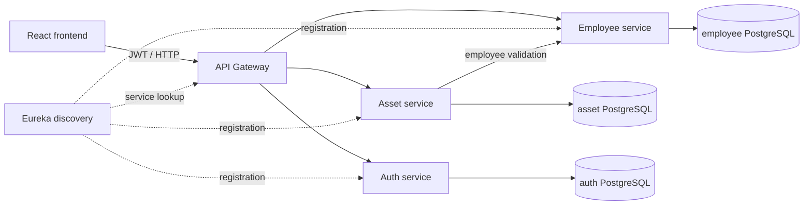
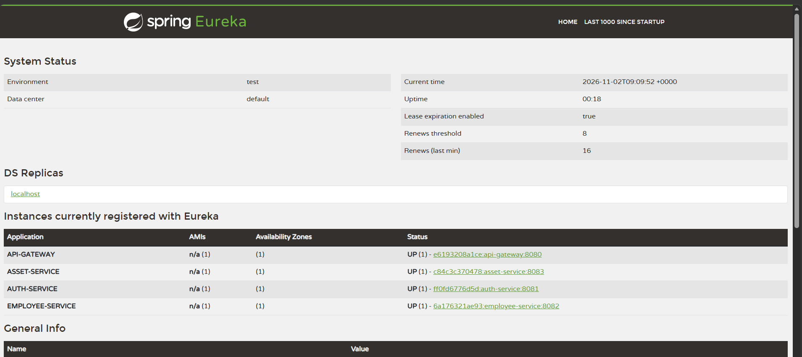
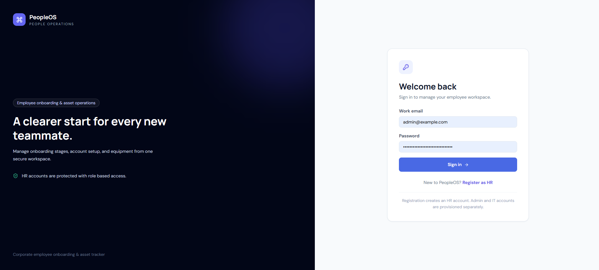
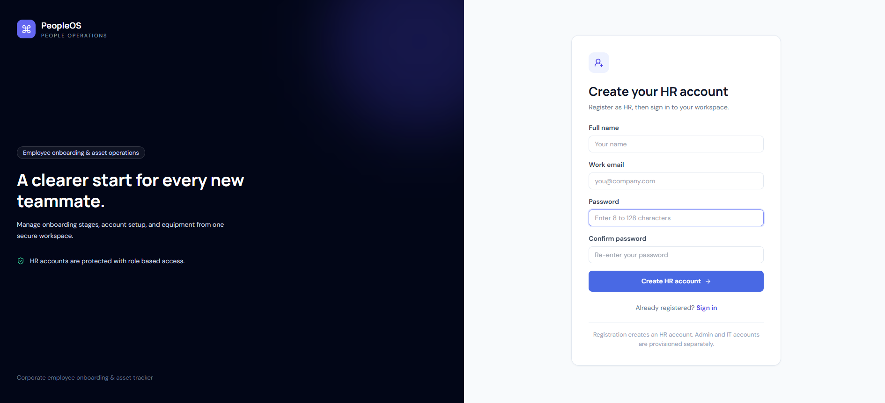
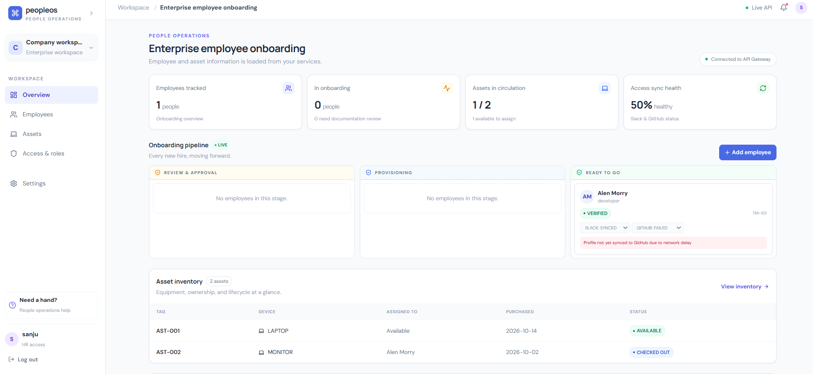
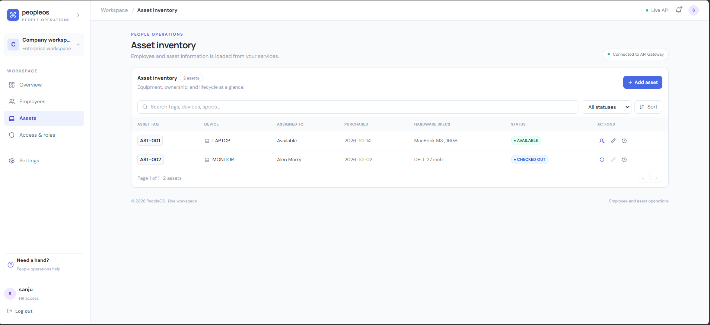
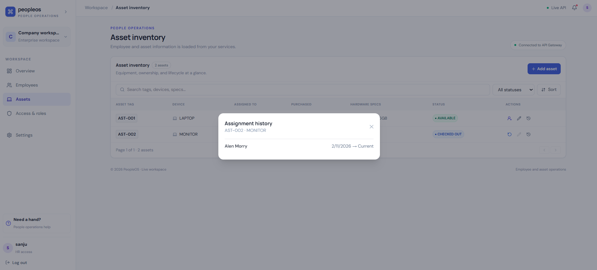
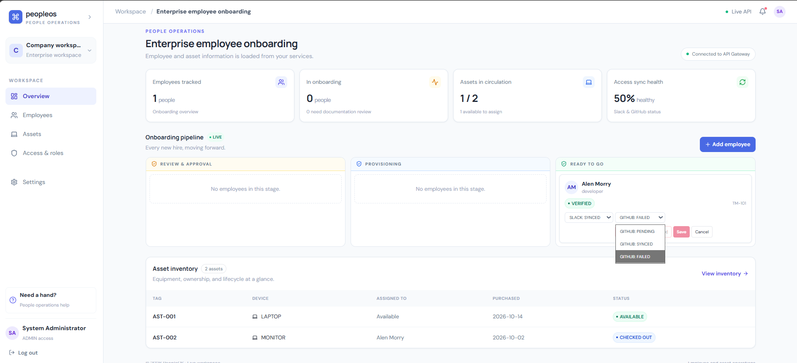
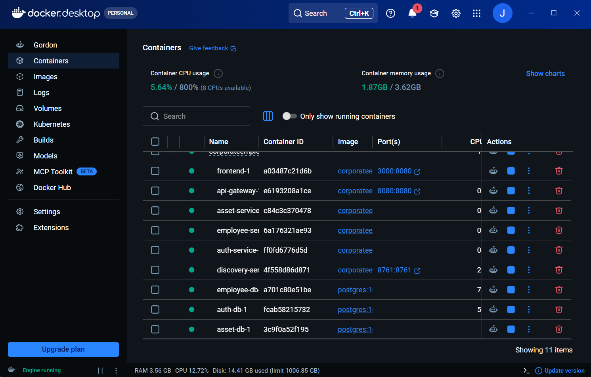
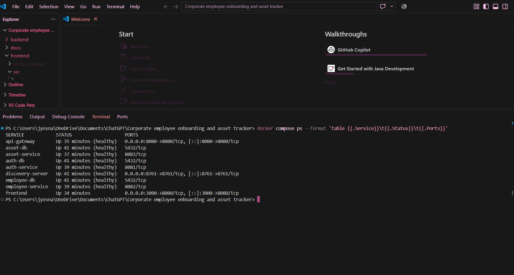

# Corporate Employee Onboarding & Asset Tracker

[](https://github.com/jyosna08/corporate-employee-onboarding-asset-tracker/actions/workflows/ci.yml)

A web application for HR and IT teams to manage employee onboarding, integration sync status, company assets, assignments, returns, and maintenance. The frontend is built with React and Vite. Five independent Spring Boot applications provide service discovery, authentication, employee and asset APIs, and the public API Gateway.

## Architecture



| Application      | Purpose                                                        | Local address            |
| ---------------- | -------------------------------------------------------------- | ------------------------ |
| React frontend   | Employee and asset management interface                        | `http://localhost:3000`  |
| API Gateway      | Public API, JWT validation, role checks, dashboard aggregation | `http://localhost:8080`  |
| discovery-server | Eureka service registry                                        | `http://localhost:8761`  |
| auth-service     | Registration, login, and JWT issuance                          | Internal Compose network |
| employee-service | Employee profiles, onboarding, sync state                      | Internal Compose network |
| asset-service    | Inventory, assignment history, return, maintenance             | Internal Compose network |
| PostgreSQL       | Separate databases for auth, employees, and assets             | Internal Compose network |

Browser and Postman API calls go through the gateway. Services and database ports are not published by Compose. HR and IT accounts have scoped permissions; the bootstrap account is ADMIN. Public registration creates HR accounts only.

## Run locally

Requirements: Docker Desktop with Docker Compose. For local frontend development, install Node.js and npm as well.

1. In the project root, create `.env` from the local template if it does not already exist, then replace its placeholder passwords and JWT secret:

   ```powershell
   if (-not (Test-Path .env)) { Copy-Item .env.example .env }
   ```

2. Start the stack:

   ```powershell
   docker compose --parallel 1 --env-file .env up --build
   ```

3. Open `http://localhost:3000`. Sign in with `AUTH_BOOTSTRAP_EMAIL` and `AUTH_BOOTSTRAP_PASSWORD` from `.env`; the auth service provisions that ADMIN account on startup.

4. Stop the stack with Ctrl+C, or run `docker compose --env-file .env down`. Add `-v` only when you intend to delete the local database volumes and data.

For frontend development with Vite, start the backend stack and run this from `frontend/`:

```powershell
npm install
npm run dev
```

Open the URL printed by Vite, usually `http://localhost:5173`. Ensure that origin is included in `CORS_ALLOWED_ORIGINS` in `.env`.

## Test and build

Use Java 17 for backend verification. From `backend/`:

```powershell
mvn -B verify
```

The latest recorded backend result is 23 passing tests; see [docs/TEST_REPORT.md](docs/TEST_REPORT.md). From `frontend/`, install dependencies and create a production build:

```powershell
npm install --include=optional --no-audit --no-fund
npm run build
```

The CI workflow runs the backend verification and frontend build, then builds Compose images. Manual test guidance and Postman instructions are in [docs/09_TESTING.md](docs/09_TESTING.md). The implementation and external delivery checklist is in [docs/DEFINITION_OF_DONE.md](docs/DEFINITION_OF_DONE.md).

## Postman

Import the collection and environment from the root [`postman/`](postman/) folder. Select **Corporate Tracker Local**, set HR and IT credentials, and use the login requests to populate their tokens. HR registration is available for a new account; run it once. IT accounts are provisioned separately.

The collection covers auth, employee records and onboarding, sync updates, assets and assignment history, return, maintenance and maintenance resolution, and dashboard. Requests that create records write to the database; update the environment's employee number, email, and asset tag before repeating them. The Auth Service Health request requires a direct service URL because the health endpoint is not published through the gateway.

## Screenshots

### Eureka service registry



### Sign in and HR registration





### Dashboard and onboarding pipeline



### Asset inventory and assignment history





### Sync failure details



### Local containers and Compose health





## Project documentation

- [Architecture](docs/03_ARCHITECTURE.md)
- [API contract](docs/05_API_CONTRACT.md)
- [Testing guide](docs/09_TESTING.md)
- [Deployment notes](docs/10_DEPLOYMENT.md)
- [Definition of done](docs/DEFINITION_OF_DONE.md)
