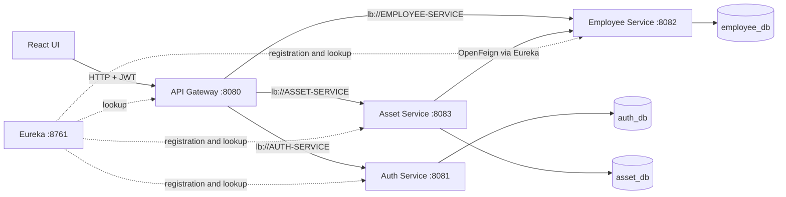
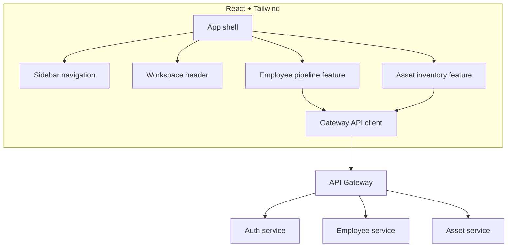
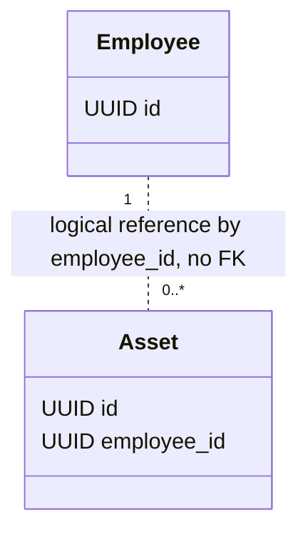
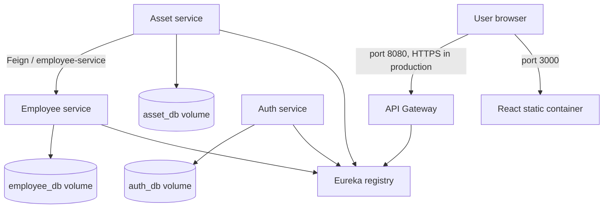

# Architecture

## Assumptions

- The workspace began empty, so these services form the first implementation rather than a migration from a local monolith.
- The React client is served separately and calls only the API Gateway. Service ports are not published by Compose.
- Each Spring Boot application can be built and deployed separately from its own folder; the backend Maven parent only centralizes dependency versions and compilation settings.
- PostgreSQL databases are isolated by service. Cross-service identity references are UUID values and are validated over HTTP when needed.
- Eureka service discovery and synchronous HTTP are the only service-to-service discovery/communication mechanisms in scope.

## High-level topology



## Service responsibilities

| Application | Runtime port | Responsibility |
| --- | ---: | --- |
| `discovery-server` | 8761 | Eureka registry; holds no business data |
| `api-gateway` | 8080 | Public routing, JWT signature/expiry and role checks, CORS, dashboard aggregation |
| `auth-service` | 8081 | Credential verification, role lookup, signed JWT issuance |
| `employee-service` | 8082 | Employee profiles, onboarding transitions, employment and integration-sync states |
| `asset-service` | 8083 | Inventory lifecycle and assignment history; verifies employee status before assignment |

The five applications are separate deployables with their own Spring Boot entry points and containers. Employee and asset services own separate PostgreSQL databases. The discovery server, gateway, and auth service also have their own application identity; only auth, employee, and asset currently require relational databases.

## Trust and authentication flow

1. The UI submits credentials to the public `/api/auth/login` gateway path.
2. Auth-service reads the normalized email from `auth_db`, verifies a BCrypt password hash, and returns a signed HS256 token with subject, role, issue time, and expiry.
3. The gateway verifies the signature and expiry on every non-login API request, applies the role matrix, and forwards sanitized identity headers.
4. Service ports are not published externally in the Compose configuration; clients use only the gateway.

## Asset assignment flow

1. Asset-service locks the asset row and checks that the lifecycle status is `AVAILABLE`.
2. Asset-service asks employee-service through an OpenFeign client identified as `employee-service`; Eureka resolves the live instance.
3. Assignment is allowed only for an `ACTIVE` employee. The asset row and assignment-history insert commit in one asset database transaction.
4. The Feign timeout and circuit breaker map a downstream outage to an explicit 503 response. No assignment write happens on this failure.

## Component responsibilities



## Backend package structure

Each business service uses a base package under `com.trainingmug` and keeps its API and persistence layers inside that application. Request flow is UI -> API Gateway -> service controller -> service logic -> repository -> that service's database.

```text
backend/
  discovery-server/src/main/java/com/trainingmug/discovery/
    DiscoveryServerApplication.java
  api-gateway/src/main/java/com/trainingmug/gateway/
    controller/   DashboardController
    security/     JwtAuthorizationFilter, RoleAccessPolicy
    config/       Dashboard CORS configuration
    constants/    Gateway routes, headers, and labels
  auth-service/src/main/java/com/trainingmug/auth/
    controller/   AuthController
    dto/          Login, registration, and response records
    entity/       UserEntity
    enums/        UserRole
    mapper/       AuthMapper
    repository/   UserRepository
    service/      AuthService, TokenService
    exception/    Custom exceptions and GlobalExceptionHandler
    config/       Password and bootstrap-admin configuration
  employee-service/src/main/java/com/trainingmug/employee/
    controller/   EmployeeController
    dto/          Employee request and response records
    entity/       Employee and integration-sync entities
    enums/        Employment, onboarding, and sync statuses
    mapper/       EmployeeMapper
    repository/   Employee repositories
    service/      EmployeeService
    exception/    Custom exceptions and GlobalExceptionHandler
  asset-service/src/main/java/com/trainingmug/asset/
    controller/   AssetController
    dto/          Asset, assignment, and employee response records
    entity/       Asset and assignment entities
    enums/        Asset types and lifecycle statuses
    mapper/       AssetMapper
    repository/   Asset repositories
    service/      AssetService
    client/       Employee-service Feign client and fallback
    exception/    Custom exceptions and GlobalExceptionHandler
    constants/    Page defaults and shared integration values
```

Controllers bind HTTP requests and delegate use cases to services. Services own business rules and transactions. Mappers convert entities to response DTOs, and repositories own persistence queries. Each service handles its own validation and API errors. DTOs are separate top-level records, one public type per file. The gateway checks JWTs and role/path access before routing requests.

## Logical employee and asset relationship

Employee and asset data live in separate databases. `asset-service` stores `employee_id` as a plain UUID reference and validates the employee through the service API when assigning an asset. It does not define a cross-database foreign key.



## Deployment topology



Only the frontend, gateway, and Eureka console publish host ports in the local Compose profile. PostgreSQL and business-service ports remain internal.

## Build and deployment boundaries

- `backend/pom.xml` is a Maven reactor for convenient local builds. Each service has an independent `pom.xml`, executable jar, Dockerfile, port, and `spring.application.name`.
- `docker-compose.yml` starts the registry, three PostgreSQL databases, three business services, gateway, and frontend as separate containers.
- Runtime URLs, database credentials, JWT key, CORS origins, and timeouts are injected through environment variables. `.env.example` contains local-only placeholders.
- Secrets must be supplied from a deployment secret manager in hosted environments; the example file is not a production secret store.
