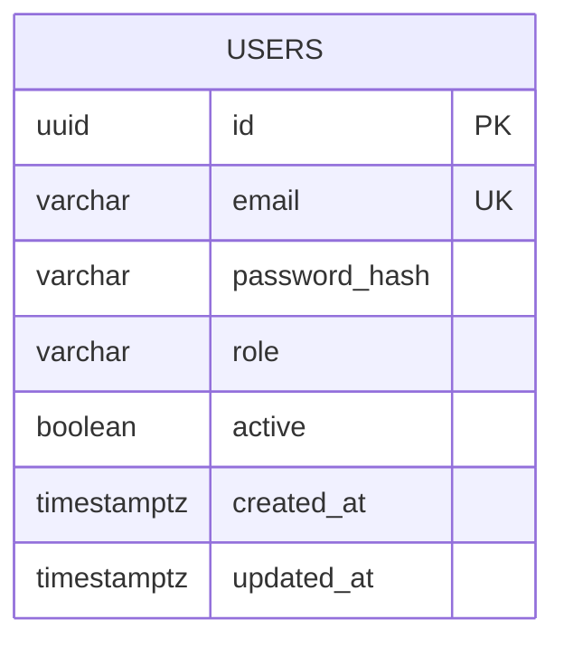
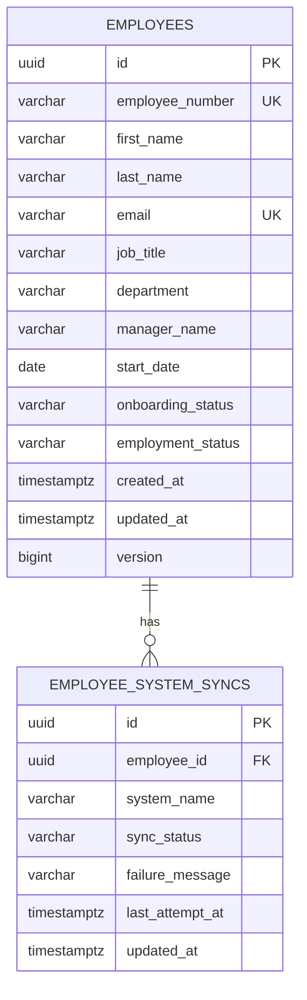
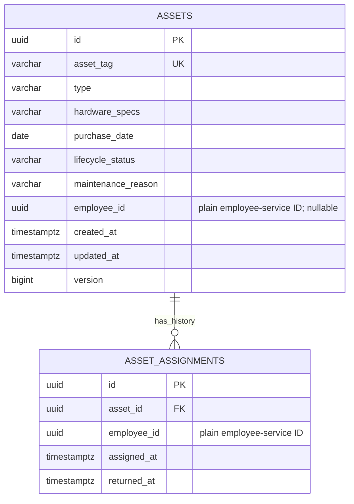

# Database Design

## Assumptions

- The repository contains an early prototype. The schema here is the target design for the service refactor; any prototype schema/data is disposable and is not the production source of truth.
- Each deployable service owns its PostgreSQL database. Services never read another service's database and there are no cross-database foreign keys.
- IDs are generated by the owning service and represented as UUIDs. References crossing service boundaries are plain UUID values.
- Timestamps are stored as `timestamptz` in UTC. PostgreSQL naming uses `snake_case`.
- Employee onboarding status and employment status are separate concepts. A verified employee can later be terminated; terminating an employee blocks new asset assignments.
- Employee-service records Slack and GitHub synchronization independently, including a failure message and last-attempt timestamp for each integration.
- Asset availability is represented consistently by `lifecycle_status = AVAILABLE` and `employee_id IS NULL`; assigned assets have `CHECKED_OUT` and a non-null employee ID. Maintenance assets cannot be assigned.
- Authentication uses a service-owned users table. Passwords are stored as adaptive hashes; JWTs contain subject and role claims, never password data.
- Flyway owns schema changes. The schemas below describe the initial relational model, not SQL migration syntax.

## Service database boundaries

| Service | Database | Owns |
| --- | --- | --- |
| auth-service | `auth_db` | Login identities and roles |
| employee-service | `employee_db` | Employee profile, onboarding, and integration sync state |
| asset-service | `asset_db` | Asset inventory and assignment history |

The discovery server and gateway are stateless and do not require PostgreSQL databases.

## auth-service schema (`auth_db`)

### `users`

| Column | Type | Constraints / notes |
| --- | --- | --- |
| `id` | UUID | Primary key, generated by service |
| `email` | VARCHAR(320) | Required, unique, normalized to lowercase |
| `password_hash` | VARCHAR(255) | Required adaptive hash; never returned by API |
| `role` | VARCHAR(16) | Required, one of `ADMIN`, `HR`, `IT` |
| `active` | BOOLEAN | Required, default `true` |
| `created_at` | TIMESTAMPTZ | Required |
| `updated_at` | TIMESTAMPTZ | Required |

### Indexes and constraints

- Unique index on `lower(email)` to prevent case-variant duplicate accounts.
- Check constraint on `role` for `ADMIN`, `HR`, or `IT`.
- Check constraint on email being non-blank; API validation also checks email syntax.

## employee-service schema (`employee_db`)

### `employees`

| Column | Type | Constraints / notes |
| --- | --- | --- |
| `id` | UUID | Primary key |
| `employee_number` | VARCHAR(32) | Required, unique business identifier |
| `first_name` | VARCHAR(100) | Required |
| `last_name` | VARCHAR(100) | Required |
| `email` | VARCHAR(320) | Required, unique, normalized to lowercase |
| `job_title` | VARCHAR(120) | Required |
| `department` | VARCHAR(120) | Required |
| `manager_name` | VARCHAR(200) | Optional; no cross-service manager relation |
| `start_date` | DATE | Required |
| `onboarding_status` | VARCHAR(24) | Required: `PENDING_REVIEW`, `IN_PROGRESS`, `VERIFIED` |
| `employment_status` | VARCHAR(16) | Required: `ACTIVE`, `TERMINATED` |
| `created_at` | TIMESTAMPTZ | Required |
| `updated_at` | TIMESTAMPTZ | Required |
| `version` | BIGINT | Required optimistic-lock version |

### `employee_system_syncs`

| Column | Type | Constraints / notes |
| --- | --- | --- |
| `id` | UUID | Primary key |
| `employee_id` | UUID | Required FK to `employees.id` within `employee_db` |
| `system_name` | VARCHAR(16) | Required: `SLACK` or `GITHUB` |
| `sync_status` | VARCHAR(16) | Required: `PENDING`, `SYNCED`, `FAILED` |
| `failure_message` | VARCHAR(1000) | Nullable; populated on failure |
| `last_attempt_at` | TIMESTAMPTZ | Nullable until attempted |
| `updated_at` | TIMESTAMPTZ | Required |

Each employee receives two sync rows at creation, one for Slack and one for GitHub. The lane UI summarizes each employee's aggregate sync state: all synced is complete, any failed is attention required, otherwise pending/in progress.

### Indexes and constraints

- Unique index on `employee_number`.
- Unique index on `lower(email)`.
- Index on `(onboarding_status, start_date)` for pipeline lanes.
- Index on `(employment_status, last_name, first_name)` for employee lookup.
- Unique constraint on `(employee_id, system_name)` in `employee_system_syncs`.
- Index on `(employee_id, sync_status)` for employee detail and sync attention queries.
- Foreign key from sync rows to employees with `ON DELETE CASCADE` (same database only).
- Check constraints for the documented status values and nonblank required strings.

## asset-service schema (`asset_db`)

### `assets`

| Column | Type | Constraints / notes |
| --- | --- | --- |
| `id` | UUID | Primary key |
| `asset_tag` | VARCHAR(40) | Required, unique, human-facing identifier |
| `type` | VARCHAR(80) | Required, e.g. `LAPTOP`, `MONITOR`, `DOCK` |
| `hardware_specs` | VARCHAR(1000) | Required |
| `purchase_date` | DATE | Required |
| `lifecycle_status` | VARCHAR(24) | Required: `AVAILABLE`, `CHECKED_OUT`, `MAINTENANCE_ALERT` |
| `maintenance_reason` | VARCHAR(500) | Nullable except while in maintenance |
| `employee_id` | UUID | Nullable plain reference to employee-service; deliberately no FK |
| `created_at` | TIMESTAMPTZ | Required |
| `updated_at` | TIMESTAMPTZ | Required |
| `version` | BIGINT | Required optimistic-lock version |

### `asset_assignments`

| Column | Type | Constraints / notes |
| --- | --- | --- |
| `id` | UUID | Primary key |
| `asset_id` | UUID | Required FK to `assets.id` in `asset_db` |
| `employee_id` | UUID | Required plain reference to employee-service; deliberately no FK |
| `assigned_at` | TIMESTAMPTZ | Required |
| `returned_at` | TIMESTAMPTZ | Nullable while active |

At most one open assignment may exist per asset. History rows are retained after returns. Assignment and asset status changes happen in one asset-service database transaction.

### Indexes and constraints

- Unique index on `asset_tag`.
- Index on `(lifecycle_status, type)` for inventory filtering.
- Index on `employee_id` for current employee inventory.
- Index on `(purchase_date DESC)` for inventory sorting.
- Index on `(asset_id, assigned_at DESC)` for asset history.
- Index on `(employee_id, assigned_at DESC)` for employee assignment history.
- Partial unique index on `asset_assignments(asset_id) WHERE returned_at IS NULL` to prevent multiple open assignments.
- Foreign key from `asset_assignments.asset_id` to `assets.id` with restricted deletion while history exists.
- Check constraint on asset lifecycle values, nonblank tag/type/specs, and employee/status consistency (`AVAILABLE` implies null `employee_id`; `CHECKED_OUT` implies non-null `employee_id`; maintenance implies null `employee_id`).
- Check constraint on assignment dates (`returned_at IS NULL OR returned_at >= assigned_at`).

## Cross-service relationship rules

- `assets.employee_id` and `asset_assignments.employee_id` are UUID values only. They do not create database foreign keys.
- Before assignment, asset-service calls employee-service synchronously through OpenFeign/Eureka and requires the employee to exist with `employment_status = ACTIVE`.
- A terminated employee may retain historical assignments; the UI should show returned/history data without implying an active assignment.
- A failed employee-service call returns a clear 503 and leaves the asset and assignment history unchanged.
