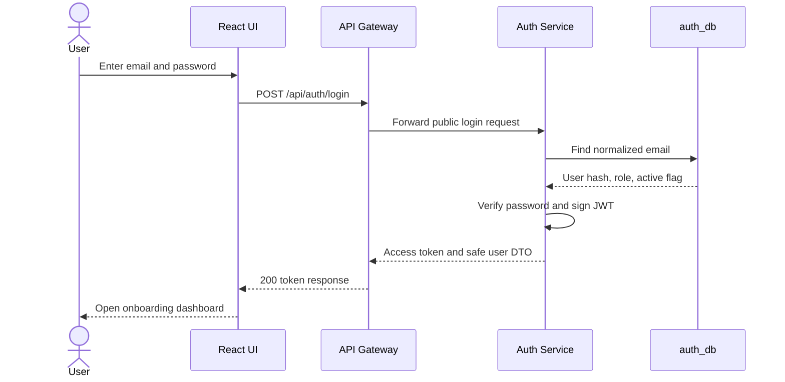

# API Contract

## Assumptions

- This contract is the approved target API for the prototype refactor; endpoints may differ from the current prototype until each service implementation is aligned.
- All browser and client traffic goes through API Gateway on port 8080. Paths below are gateway paths; service names are never exposed to clients.
- Authentication uses a signed bearer JWT. HR registration and login are public; every business-data route requires a valid token. Public registration always creates the `HR` role; `ADMIN` and `IT` accounts are provisioned separately.
- Role policy: `ADMIN` can manage all records and users; `HR` can manage employee profiles and onboarding and can create/update/assign/return assets; `IT` can read employees for assignment checks and manage assets, including maintenance. All authenticated roles can read the overview dashboard.
- IDs are UUIDs. All JSON timestamps are ISO-8601 UTC strings. Asset pagination uses Spring Data's `{ "content": [], "number": 0, "size": 20, "totalElements": 0, "totalPages": 0 }` shape.
- Validation errors (including malformed JSON) use `400` with field-level details when available; missing resources `404`; invalid credentials `401`; insufficient role `403`; duplicate/conflict/state transition errors `409`; downstream employee-service unavailability `503`; unexpected errors `500`. Error responses always have a non-empty `message`.
- Employee create starts at `PENDING_REVIEW` and `ACTIVE`; it creates pending Slack and GitHub sync states. The only forward onboarding transitions are `PENDING_REVIEW -> IN_PROGRESS -> VERIFIED`.
- An asset may be assigned only when available and only to an active employee. Assignment return closes the active history record and marks the asset available. Maintenance assets cannot be assigned.
- Dashboard metrics and lanes are read models assembled by gateway-facing endpoints. The frontend may fetch these endpoints independently; it does not call service ports directly.
- The React frontend is in scope and calls only the API Gateway; the backend services remain separately deployable applications.

## Shared response shapes

## Authentication

### Register an HR account

`POST /api/auth/register`

```json
{ "fullName": "Jordan Davis", "email": "jordan@example.com", "password": "Passw0rd" }
```

Request body fields: `fullName` and `email`; `password` must contain 8-128 characters. Returns `201` with the created user's `id`, `fullName`, `email`, and fixed `HR` role. Duplicate email returns `409`. Registration does not sign the user in; the user then calls the login endpoint.

### Login

`POST /api/auth/login` returns an access token and a user object containing the database-backed display name and role. The UI stores the token for API Gateway calls and shows the signed-in user's name in the sidebar.

### Error response

```json
{
  "timestamp": "2026-10-31T09:30:00Z",
  "status": 409,
  "code": "INVALID_STATE_TRANSITION",
  "message": "Employee can only move from PENDING_REVIEW to IN_PROGRESS.",
  "path": "/api/employees/9d3377d5-8a9e-45b1-a81f-215ad6224730/onboarding/advance",
  "details": []
}
```

Validation errors may populate `details` with `{ "field": "email", "message": "must be a valid email" }` objects.

### Employee response

```json
{
  "id": "9d3377d5-8a9e-45b1-a81f-215ad6224730",
  "employeeNumber": "TM-1042",
  "firstName": "Danila",
  "lastName": "Shanen",
  "email": "danila.shanen@example.com",
  "jobTitle": "Product Designer",
  "department": "Design",
  "managerName": "Maya Chen",
  "startDate": "2026-11-16",
  "onboardingStatus": "PENDING_REVIEW",
  "employmentStatus": "ACTIVE",
  "systemSyncs": [
    { "system": "SLACK", "status": "PENDING", "failureMessage": null, "lastAttemptAt": null },
    { "system": "GITHUB", "status": "FAILED", "failureMessage": "Profile not yet synced to GitHub due to network delay", "lastAttemptAt": "2026-10-31T09:20:00Z" }
  ],
  "createdAt": "2026-10-31T09:00:00Z",
  "updatedAt": "2026-10-31T09:20:00Z"
}
```

### Asset response

```json
{
  "id": "c1cd9a68-3fc2-42df-ae1f-bd1e6509aa0c",
  "assetTag": "AST-707",
  "type": "LAPTOP",
  "hardwareSpecs": "MacBook Pro M3, 16 GB RAM, 512 GB SSD",
  "purchaseDate": "2026-04-28",
  "lifecycleStatus": "CHECKED_OUT",
  "maintenanceReason": null,
  "employeeId": "9d3377d5-8a9e-45b1-a81f-215ad6224730",
  "assignedAt": "2026-10-31T09:15:00Z"
}
```

## Authentication and authorization

| Method | Gateway path | Roles | Purpose |
| --- | --- | --- | --- |
| POST | `/api/auth/login` | Public | Obtain JWT |

### `POST /api/auth/login`

- Request body: `email` (valid email, required), `password` (8-128 characters).
- Success: `200 OK`; invalid credentials or inactive account: `401`.
- Sample request:

```json
{ "email": "hr@example.com", "password": "Passw0rd" }
```

- Sample response:

```json
{
  "accessToken": "eyJhbGciOi...",
  "tokenType": "Bearer",
  "expiresIn": 3600,
  "user": { "id": "2b5fed89-9ead-4c95-a578-b11e7b9b4587", "email": "hr@example.com", "role": "HR" }
}
```

- Passwords and hashes are never included in responses. No user provisioning endpoint is exposed in this initial scope; accounts are provisioned administratively.

## Dashboard and pipeline

### `GET /api/dashboard/overview`

- Roles: `ADMIN`, `HR`, `IT`.
- Query params: none.
- Success: `200`; response is a snapshot of summary counts for dashboard cards.
- Sample response:

```json
{
  "employeesByOnboardingStatus": { "PENDING_REVIEW": 5, "IN_PROGRESS": 3, "VERIFIED": 12 },
  "systemSync": { "PENDING": 2, "FAILED": 1, "SYNCED": 17 },
  "assetsByLifecycleStatus": { "AVAILABLE": 8, "CHECKED_OUT": 31, "MAINTENANCE_ALERT": 2 }
}
```

The UI groups the returned employee DTOs into the three visual lanes. Sync details and failure messages are included with each employee DTO.

## Employee endpoints

### `POST /api/employees`

- Roles: `ADMIN`, `HR`.
- Request: required `employeeNumber`, `firstName`, `lastName`, `email`, `jobTitle`, `department`, `startDate`; optional `managerName`.
- Validation: employee number 1-32 chars; names 1-100; email valid and unique; job title 1-120; department 1-120; start date valid.
- Success: `201 Created` with employee DTO and `Location: /api/employees/{id}`; duplicate number/email: `409`; invalid input: `400`.
- Sample body:

```json
{
  "employeeNumber": "TM-1042",
  "firstName": "Danila",
  "lastName": "Shanen",
  "email": "danila.shanen@example.com",
  "jobTitle": "Product Designer",
  "department": "Design",
  "managerName": "Maya Chen",
  "startDate": "2026-11-16"
}
```

### `GET /api/employees`

- Roles: `ADMIN`, `HR`, `IT`.
- Query params: optional `search` (name, employee number, or email).
- Success: `200` with up to 100 employee DTOs, ordered newest first; the UI groups the results into lanes. Invalid/malformed search is safely treated as text.

### `GET /api/employees/{employeeId}`

- Roles: `ADMIN`, `HR`, `IT`.
- Path variable: UUID `employeeId`.
- Success: `200` employee DTO; malformed UUID: `400`; unknown ID: `404`.

### `PUT /api/employees/{employeeId}`

- Roles: `ADMIN`, `HR`.
- Request: same editable profile fields as create; onboarding and employment statuses cannot be changed through this endpoint.
- Success: `200` employee DTO; `400`, `404`, or `409` on validation/conflict.

### `POST /api/employees/{employeeId}/onboarding/advance`

- Roles: `ADMIN`, `HR`.
- Body: empty.
- Success: `200` updated employee DTO. Allowed transitions only `PENDING_REVIEW -> IN_PROGRESS` and `IN_PROGRESS -> VERIFIED`. Attempting to advance VERIFIED: `409 INVALID_STATE_TRANSITION`; unknown employee: `404`.

### `PATCH /api/employees/{employeeId}/employment-status`

- Roles: `ADMIN`, `HR`.
- Request body: `{ "status": "TERMINATED" }`; allowed target: `ACTIVE` or `TERMINATED`.
- Success: `200` employee DTO; invalid transition/value: `400` or `409`; unknown employee: `404`.
- Termination does not erase onboarding or asset history. Asset assignment to a terminated employee is rejected by asset-service.

### `PATCH /api/employees/{employeeId}/system-sync/{system}`

- Roles: `ADMIN`, `IT`.
- Path variable `system`: `SLACK` or `GITHUB`.
- Request body: `{ "status": "SYNCED", "failureMessage": null }`; `failureMessage` is required and nonblank for `FAILED`, and must be null for `SYNCED` or `PENDING`.
- Success: `200` employee DTO with updated sync states; invalid status/system: `400`; employee missing: `404`.
- This is an administrative state update for the integration workflow. External Slack/GitHub provisioning itself is outside this API scope.

## Asset endpoints

### `POST /api/assets`

- Roles: `ADMIN`, `IT`.
- Body: required `assetTag`, `type`, `hardwareSpecs`, `purchaseDate`; lifecycle status and employee ID are server-managed on create (`AVAILABLE`, null).
- Validation: asset tag 1-40 chars; type 1-80; hardware specs 1-1000; purchase date cannot be in the future.
- Success: `201 Created` asset DTO and Location header; duplicate tag: `409`; invalid input: `400`.
- Sample body:

```json
{ "assetTag": "AST-707", "type": "LAPTOP", "hardwareSpecs": "MacBook Pro M3, 16 GB RAM, 512 GB SSD", "purchaseDate": "2026-04-28" }
```

### `GET /api/assets`

- Roles: `ADMIN`, `HR`, `IT`.
- Query params: `page` (default 0), `size` (default 20, max 100), `sort` (allowlisted: `assetTag`, `type`, `purchaseDate`, `lifecycleStatus`; asc/desc), `search` (tag/type/specs), optional `status` (one lifecycle status), optional `type` (one type).
- Success: `200` paginated asset DTOs in a Spring Page response; invalid sort/filter/UUID: `400`.

### `GET /api/assets/{assetId}`

- Roles: `ADMIN`, `HR`, `IT`.
- Success: `200` asset DTO; invalid UUID: `400`; missing asset: `404`.

### `PUT /api/assets/{assetId}`

- Roles: `ADMIN`, `IT`.
- Body: editable `assetTag`, `type`, `hardwareSpecs`, `purchaseDate`; assignment state cannot be edited here.
- Success: `200` asset DTO; `400`, `404`, or `409` on validation/conflict.

### `POST /api/assets/{assetId}/assignments`

- Roles: `ADMIN`, `IT`.
- Path variable: UUID `assetId`.
- Request body: `{ "employeeId": "9d3377d5-8a9e-45b1-a81f-215ad6224730" }`.
- Behavior: verifies employee existence and ACTIVE status by synchronous Feign call through Eureka; in one asset-db transaction sets `employee_id`, changes lifecycle to `CHECKED_OUT`, and inserts assignment history.
- Success: `201 Created` with assignment DTO; asset not available or maintenance conflict: `409`; employee missing: `404`; terminated employee: `409`; employee-service unavailable/timeout: `503` and no write occurs; invalid ID: `400`.
- Sample response:

```json
{
  "id": "14f1868a-d182-4ac4-8d9f-80a1d856bd08",
  "assetId": "c1cd9a68-3fc2-42df-ae1f-bd1e6509aa0c",
  "employeeId": "9d3377d5-8a9e-45b1-a81f-215ad6224730",
  "assignedAt": "2026-10-31T09:15:00Z",
  "returnedAt": null
}
```

### `POST /api/assets/{assetId}/return`

- Roles: `ADMIN`, `IT`.
- Body: empty.
- Success: `200` updated asset DTO; asset is set to `AVAILABLE`, employee ID cleared, and active assignment receives `returnedAt`. If asset has no open assignment: `409`; missing asset: `404`.

### `POST /api/assets/{assetId}/maintenance`

- Roles: `ADMIN`, `IT`.
- Body: `{ "reason": "Battery replacement" }`; reason required, 1-500 chars.
- Success: `200` updated asset DTO with `MAINTENANCE_ALERT`; an asset currently checked out cannot be placed into maintenance until returned (`409`); missing asset: `404`.

### `GET /api/assets/{assetId}/assignments`

- Roles: `ADMIN`, `HR`, `IT`.
- Query params: `page` (default 0), `size` (default 20, max 100), sorted newest `assignedAt` first.
- Success: `200` paginated assignment history; missing asset: `404`.

## OpenAPI and gateway behavior

- Each service publishes OpenAPI for its own DTO contract; the gateway is the public entry point and should expose or aggregate the service documentation without exposing internal service URLs.
- Gateway validates JWT signature, expiration, and required claims. CORS origins are configuration, not hardcoded values. `/api/auth/login` is public; all other routes require JWT.
- Gateway applies explicit timeouts. Employee lookup from asset-service uses Feign with a bounded timeout and circuit breaker/fallback that maps dependency failure to `503 SERVICE_UNAVAILABLE`.
- No event broker or asynchronous cross-service integration is part of this design.

## Mermaid sequence diagrams

### Login flow



### Asset assignment flow

```mermaid
sequenceDiagram
    actor IT as IT User
    participant UI as React UI
    participant GW as API Gateway
    participant AS as Asset Service
    participant AD as asset_db
    participant ES as Employee Service
    participant ED as employee_db
    IT->>UI: Assign available asset to employee
    UI->>GW: POST /api/assets/{assetId}/assignments + JWT
    GW->>GW: Validate JWT and IT/ADMIN role
    GW->>AS: Forward assignment request
    AS->>AD: Load asset and verify AVAILABLE
    AS->>ES: Feign lookup by Eureka service name
    ES->>ED: Read employee by ID
    ED-->>ES: Employee and ACTIVE/TERMINATED status
    ES-->>AS: Employee DTO
    alt employee active and asset available
        AS->>AD: Transaction: set employee_id/CHECKED_OUT and insert history
        AD-->>AS: Commit assignment
        AS-->>GW: 201 assignment DTO
        GW-->>UI: Assignment created
        UI-->>IT: Refresh inventory and employee card
    else employee terminated, asset unavailable, or maintenance
        AS-->>GW: 409 conflict; no mutation
        GW-->>UI: Error response
    else employee service unavailable
        AS-->>GW: 503 dependency unavailable; no mutation
        GW-->>UI: Retryable error response
    end
```
